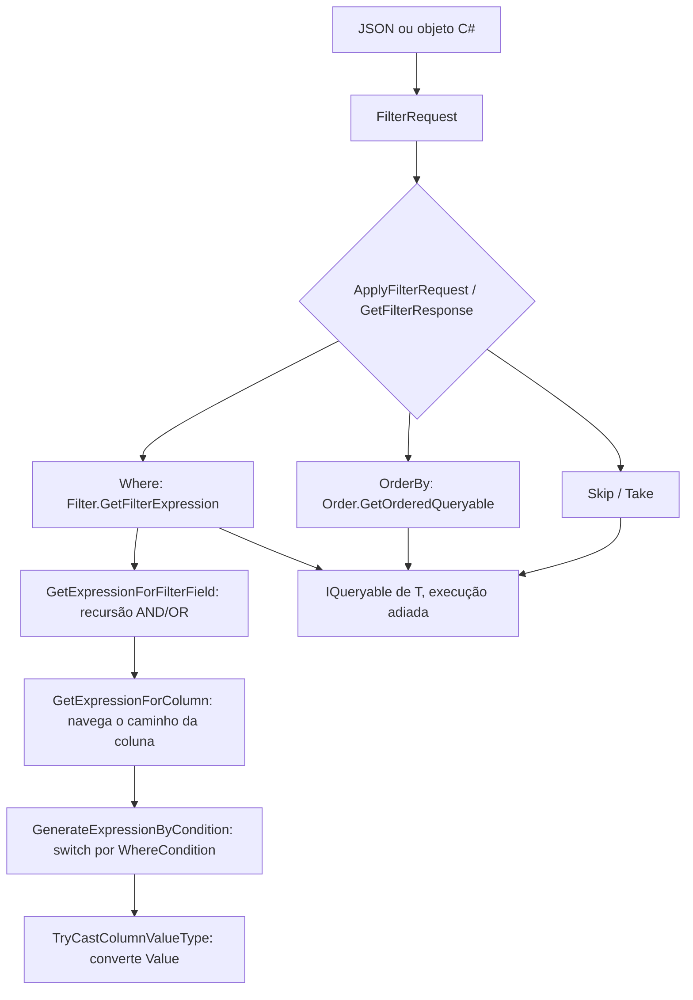

# Arquitetura interna

Como a biblioteca transforma um `FilterRequest` em uma árvore de expressões LINQ. Página voltada a quem mantém ou estende o código.

## Visão geral

A biblioteca não tem dependências externas (apenas `netstandard2.0`) e tem ~830 linhas em 13 arquivos, todos no namespace único `Vip.DynamicFilter` (as pastas são só organização).

| Camada | Arquivos | Visibilidade | Papel |
|---|---|---|---|
| Contratos (DTOs) | `Models/Where.cs`, `Models/Filter.cs`, `Models/Order.cs`, `Requests/FilterRequest.cs`, `Responses/FilterResponse.cs` | pública | Carregam os critérios; convertem tokens string em enums |
| Enums | `Enums/WhereCondition.cs`, `Enums/Operator.cs`, `Enums/OrderDirection.cs` | pública | Vocabulário de condições, operadores e direções |
| | `Enums/OrderStep.cs` | interna | Distingue `OrderBy` (`First`) de `ThenBy` (`Next`) |
| Fachada | `Extensions/QueryableExtensions.cs`, `Extensions/ResponseExtensions.cs` | pública | Métodos de extensão sobre `IQueryable<T>` / `IEnumerable<T>` |
| Motor | `Expressions/WhereExpression.cs`, `Expressions/OrderExpression.cs` | interna | Montagem das expression trees via reflexão |

## Fluxo de uma requisição



Nada é executado até a materialização (`ToList`, `Count`, ...). A exceção é `GetFilterResponse`, que executa `Count()` e `ToList()` internamente.

## Conversão de tokens (DTOs)

Cada conceito tem **duas propriedades** que apontam para o mesmo dado: uma tipada (enum) e uma string (token). O setter da string atualiza o enum:

| Classe | Propriedade string | Propriedade enum | Valores aceitos | Valor desconhecido |
|---|---|---|---|---|
| `Where` | `Condition` | `ConditionType` | token **ou** nome do enum; dicionário `OrdinalIgnoreCase` + `Trim` | enum fica `None` e `IsConditionUnknown = true` |
| `Filter` | `Operator` | `OperatorType` | `and`, `or`, `none`; `Trim().ToLowerInvariant()` | enum fica `None` e `IsOperatorUnknown = true` |
| `Order` | `Direction` | `DirectionType` | `asc`, `desc`; `Trim().ToLowerInvariant()` | enum fica `Asc` e `IsDirectionUnknown = true` |

Os setters **não lançam** para valores desconhecidos (lançar ali faria o erro sair embrulhado em `JsonException` durante a deserialização). Eles marcam uma flag `internal`, e o motor (`WhereExpression` / `OrderExpression`) lança `ArgumentException` com o valor recebido quando o filtro ou a ordenação é aplicado. Atribuir o enum diretamente limpa a flag.

Consequências:

- A sincronização é **unidirecional** (string → enum). Definir `ConditionType` em C# não preenche `Condition`; ao serializar um `FilterRequest` montado em C#, as propriedades string saem `null`.
- Se o JSON trouxer `condition` e `conditionType`, vale o que for atribuído por último.
- Os atributos `[Description("...")]` em `WhereCondition` e `OrderDirection` são apenas documentação — o mapeamento real é o dicionário montado em `Where.CreateConditions` (os nomes do enum entram nele automaticamente). Ao adicionar uma condição é preciso alterar os três pontos (enum, dicionário de tokens e `switch` de geração).

## Motor de filtro (`WhereExpression`)

### 1. Recursão de grupos — `GetExpressionForFilterField`

- `OperatorType == None` → trata o `Filter` como condição simples (usa `Column`/`ConditionType`/`Value`; `Filters` é ignorado).
- `OperatorType == And/Or` → exige `Filters` não vazio, gera a expressão de cada filho recursivamente e combina da esquerda para a direita com `Expression.AndAlso` / `Expression.OrElse`. `Column`/`ConditionType`/`Value` do próprio grupo são ignorados.

Todos os níveis compartilham o **mesmo** `ParameterExpression` raiz (`e`), então o resultado é um único lambda `e => ...`.

### 2. Navegação da coluna — `GetExpressionForColumn`

`Column` é dividida por `.` e cada segmento é resolvido com `GetDeclaringProperty` (busca **case-insensitive** via `GetRuntimeProperties`).

Antes de resolver cada segmento, verifica-se se a expressão atual é uma coleção (`IsEnumerable`). Se for:

1. a coleção é embrulhada em `Queryable.AsQueryable<TItem>()`;
2. `GetExpression<TItem>` é invocado por reflexão (`MakeGenericMethod`) para gerar um sub-lambda **somente com o segmento atual**;
3. o resultado é `Queryable.Any(colecao, subLambda)` e a navegação **termina ali**.

Por isso `Address.Street` funciona e segmentos além do primeiro após a coleção são descartados (ver [matriz-de-comportamentos.md](matriz-de-comportamentos.md#navegação)).

### 3. Geração por condição — `GenerateExpressionByCondition`

Um `switch` sobre `WhereCondition`:

| Grupo | Expressão gerada |
|---|---|
| `Equal`, `NotEqual`, `LessThan`, `GreaterThan`, `LessThanOrEqual`, `GreaterThanOrEqual` | `Expression.<Op>(prop, valorConvertido)` |
| `StartsWith`, `Contains`, `EndsWith` (+ negações) | `Expression.Call(prop, string.<Método>(string), Constant(valor))` |
| `ContainsIgnoreCase` | `Expression.Call(prop, "Contains", valor, StringComparison.InvariantCultureIgnoreCase)` — resolvido **por nome em runtime** |
| `Any`, `NotAny` | `Queryable.Any(prop.AsQueryable())` |
| `IsNull`, `IsNotNull` | `prop == null` |
| `IsEmpty`, `IsNotEmpty`, `IsNullOrEmpty`, `IsNotNullOrEmpty` | comparação com `string.Empty` (validam `prop.Type == string`) |

### 4. Valores como "parâmetro" — `ToStaticParameterExpressionOfType`

Nas comparações, o valor não entra como `Expression.Constant(valor)`. Ele é embrulhado em um objeto anônimo e lido por uma propriedade:

```csharp
Expression.Convert(Expression.Property(Expression.Constant(new { obj }), "obj"), type)
```

Isso imita a closure que o compilador C# gera para variáveis capturadas, que é o formato que provedores LINQ (como EF Core) reconhecem para **parametrizar** a consulta em vez de embutir o literal. Os métodos de string (`Contains`, `StartsWith`, `EndsWith`) **não** usam essa técnica: o valor entra como `Expression.Constant`.

### 5. Conversão de valor — `TryCastColumnValueType`

Ordem das regras:

1. `value == null` **ou** tipo da propriedade fora de `AvailableCastTypes` (e não enum) → `InvalidCastException`.
2. Tipo do valor igual ao da propriedade → usa como está.
3. Propriedade `string` → `Convert.ToString(value)`.
4. Propriedade enum → `Enum.Parse(type, texto)` (case-sensitive).
5. Demais → `Convert.ToString(value)` e depois `T.TryParse(string, out T)` localizado por reflexão. Para `Nullable<T>`, usa o `TryParse` de `T`.

O `TryParse(string, out T)` usa a **cultura corrente da thread**, não a invariante.

## Motor de ordenação (`OrderExpression`)

`GetOrderedQueryable<T>(order, query, step)`:

1. divide `Column` por `.` e navega propriedade a propriedade (case-insensitive; **sem** suporte a coleções);
2. cria `Func<T, TProp>` com o tipo da última propriedade;
3. escolhe o `MethodInfo` (`OrderBy`, `OrderByDescending`, `ThenBy`, `ThenByDescending`) conforme `step` e `DirectionType`;
4. invoca via `MakeGenericMethod(...).Invoke(...)`.

Os quatro `MethodInfo` são resolvidos uma única vez (campos `static readonly`).

## Exemplo real de árvore gerada

Saída de `IQueryable.Expression.ToString()` para um filtro `AND` com uma condição simples e uma sobre coleção, seguida de ordenação dupla:

```csharp
var filter = new Filter
{
    OperatorType = Operator.And,
    Filters = new List<Filter>
    {
        new("Age", WhereCondition.GreaterThanOrEqual, 5),
        new("Address.Street", WhereCondition.Contains, "Rua")
    }
};
var orders = new List<Order> { new("Age", OrderDirection.Desc), new("Name", OrderDirection.Asc) };
```

```json
{
  "where": {
    "operator": "and",
    "filters": [
      { "column": "age", "condition": ">=", "value": 5 },
      { "column": "address.street", "condition": "~", "value": "Rua" }
    ]
  },
  "orderBy": [
    { "column": "age", "direction": "desc" },
    { "column": "name", "direction": "asc" }
  ]
}
```

```text
.Where(e => ((e.Age >= Convert({ obj = 5 }.obj, Int32))
             AndAlso e.Address.AsQueryable().Any(e10 => e10.Street.Contains("Rua"))))
.OrderByDescending(xFirst => xFirst.Age)
.ThenBy(xNext => xNext.Name)
```

Os nomes de parâmetro vêm de um sufixo posicional (`e`, `e10`, ...) e de `OrderStep` (`xFirst`, `xNext`).

## Decisões e dívidas de projeto

- **Sem cache de expressões**: cada chamada remonta a árvore com reflexão. Os `MethodInfo` são cacheados; `PropertyInfo` e as árvores, não.
- **Estilo misto**: `Responses/FilterResponse.cs` e `Extensions/ResponseExtensions.cs` usam *file-scoped namespace*; os demais usam namespace com bloco. O projeto compila em `netstandard2.0` com `LangVersion=latest` (por isso `switch` expressions e `new()` funcionam).
- **Região vazia** `Available Types Collection` em `OrderExpression.cs` (resquício).
- **`byte` e `sbyte` não anuláveis** estão ausentes de `AvailableCastTypes` (apenas `byte?`/`sbyte?` constam) — provável omissão.
- **Sem XML docs** (`///`) na API pública e sem `GenerateDocumentationFile` no `.csproj`.

## Referência

- [`WhereExpression`](../src/Vip.DynamicFilter/Expressions/WhereExpression.cs)
- [`OrderExpression`](../src/Vip.DynamicFilter/Expressions/OrderExpression.cs)
- [`QueryableExtensions`](../src/Vip.DynamicFilter/Extensions/QueryableExtensions.cs)
- [`ResponseExtensions`](../src/Vip.DynamicFilter/Extensions/ResponseExtensions.cs)
